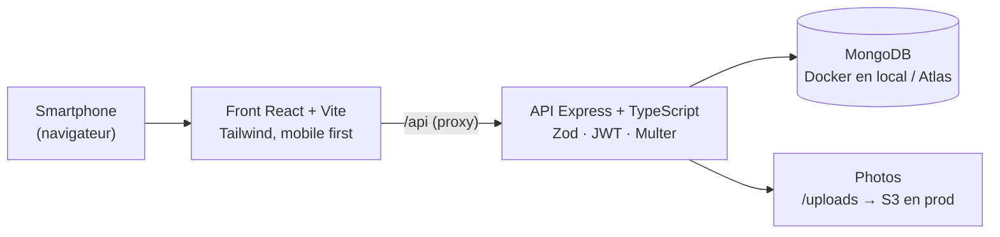

# PokeDress : dossier projet

> Inventaire du foyer · Bachelor Chef de Projet Web & Digital (B3 Nexa)
> Équipe : **Dylan Fernandes** et **Morgan Bourre** · Version du 30/10/2026
>
> Sources internes : [vision](vision-produit-inventaire.md), [recherche terrain](recherche-terrain.md), [personas](personas.md), [critères d'acceptation](criteres-acceptation.md), [fonctionnalités](fonctionnalites.md), spec `specs/001-universal-containment/spec.md`.
>
> **Règle de lecture** : chaque chiffre est soit **sourcé** (lien vers la recherche), soit marqué **hypothèse**. Aucun chiffre n'est présenté comme un résultat s'il n'a pas été mesuré.

---

## 1. Notre vision du projet

### Le problème

**On ne sait pas ce qu'on possède.** Un foyer accumule des centaines d'objets sans vue d'ensemble. Cela coûte concrètement :

- des **achats en double** (une rallonge, un pull noir, un outil) ;
- un **dressing sous-exploité** : des vêtements oubliés, jamais portés, jamais revendus ;
- des **informations éparpillées** : factures, dates d'achat et garanties perdues entre les mails et les tiroirs.

> *« Je ne peux pas répondre à la question "qu'est-ce que j'ai chez moi ?" »*

Ce n'est **pas** une application de localisation (« où est mon tournevis ? ») : c'est un **inventaire complet**.

### La cible

- **Cible MVP** : jeunes actifs de 25 à 40 ans dont le **foyer vient de se former** (emménagement seul, en colocation ou à plusieurs).
- **Pourquoi elle** : l'emménagement est le seul moment où l'on manipule tous ses objets un par un. L'effort de saisie y paraît naturel.

### La proposition de valeur

> **« Tout ce que vous possédez, inventorié en quelques photos et enfin visible en un coup d'œil. »**

**Le bénéfice unique, c'est la rapidité de saisie : moins de 10 secondes par objet.** Le vrai concurrent est le tableur Excel, que tout le monde abandonne parce que c'est trop fastidieux.

### Le modèle

**Freemium.**

| | Gratuit | Premium (abonnement) |
|---|---|---|
| Objets | jusqu'à 100 | illimités |
| Membres du foyer | 2 | illimités |
| Autres | — | export PDF pour l'assurance, statistiques du dressing (après le MVP) |

**North Star Metric** : le nombre d'objets inventoriés par foyer actif.

> La vision d'origine réservait le partage au premium. Nous l'avons rendu **gratuit jusqu'à 2 membres** (décision du 29/10, voir §2.4) : notre persona principale vit à deux.

---

## 2. Résultats de la phase Discovery

### 2.1 Ce que nous avons fait

| Étape | Livrable | État |
|---|---|---|
| Recherche documentaire (marché, usages, concurrents) | [recherche-terrain.md](recherche-terrain.md) | ✅ |
| Personas proto (fondés sur les données) | [personas.md](personas.md) | ✅ |
| Guide d'entretien (8 questions sur des faits passés) | recherche §9 | ✅ rédigé |
| Entretiens utilisateurs (5 à 8 personnes) | — | ❌ **pas encore menés** |
| Tests utilisateurs chronométrés (critères 👤) | — | ❌ **pas encore menés** |

**Limite à assumer devant le jury** : notre Discovery repose sur des **données secondaires**. Les personas restent des hypothèses tant que les entretiens n'ont pas eu lieu.

### 2.2 Ce que disent les données

| Constat | Chiffre | Source |
|---|---|---|
| Les 25-34 ans sont la tranche qui déménage le plus | mobilité de 40 à 50 %, chute après 30-35 ans | INSEE (étude régionale, 2018) |
| On possède deux fois plus de vêtements qu'on ne le pense | 78 pièces déclarées contre 172 constatées | ADEME / ObSoCo 2025 (via NECI, à vérifier dans l'original) |
| Plus de la moitié des vêtements stockés ne sont jamais portés | > 50 % | ADEME 2025 |
| Rythme d'achat textile | 42 articles neufs par personne en 2024 | Re_Fashion |
| Objets dormants dans les foyers | 86 % des foyers, environ 19 objets, environ 320 € | OpinionWay / Leboncoin, sept. 2025 |
| Peu de gens revendent | 17 % ; freins : temps (29 %), complexité (20 %), prix (16 %) | idem |
| Doublons quand deux personnes emménagent ensemble | 54 % ont jusqu'à 10 objets en double | sondage Kijiji, États-Unis, 2010 (**faible**) |
| Voir ce qu'on possède freine l'achat | baisse de l'intention d'achat | Raffaelli & Liu, 2024 (expériences) |
| Cambriolages de logements | environ 218 000 en 2024 ; la charge de la preuve repose sur l'assuré | SSMSI (relayé), assureurs |
| Peu de gens font un inventaire, même quand on le leur conseille | environ la moitié des propriétaires seulement | Insurance Information Institute (États-Unis) |
| Les applis d'assureurs français n'ont pas d'inventaire | MAIF, Macif : sinistres oui, inventaire non | stores, sites |

### 2.3 Ce que nous en avons appris

1. **Toutes les sources pointent la même cause d'abandon : la saisie.** Tableur, applis d'inventaire, applis de dressing : personne ne se plaint d'un manque de fonctionnalités. Notre différenciation (moins de 10 s) vise donc le bon problème.
2. **Le dressing concentre le volume.** Un dressing moyen (environ 170 pièces) dépasse à lui seul la limite gratuite.
3. **L'IA n'est pas une solution magique.** Les concurrents qui l'utilisent (Bevel, détourage chez Whering) se trompent souvent. Ça conforte « l'IA plus tard ».
4. **La peur du vol ne fait pas agir.** L'assurance vient en bénéfice secondaire, pas comme argument principal.
5. **Le partage ne vaut que si l'autre membre contribue.** Il faut qu'il soit gratuit et très rapide pour lui.

### 2.4 Décisions prises grâce à la Discovery

| Date | Décision | Pourquoi |
|---|---|---|
| 29/10 | On parle de **foyer**, pas de couple | L'inventaire « chez nous » vaut pour un couple, une colocation, une famille ou une personne seule. |
| 29/10 | Le **dressing est une catégorie** enrichie, pas un module à part | Une seule saisie, un seul modèle d'objet. |
| 29/10 | Le **mur des 100 objets** sert de déclencheur du premium | L'utilisateur y arrive investi. On ne verrouille jamais la lecture. |
| 29/10 | **Partage gratuit jusqu'à 2 membres** | La persona principale vit à deux. |
| 29/10 | 3 champs obligatoires (nom, pièce, catégorie), avec **ajout enchaîné** | Pour tenir les 10 s, la pièce et la catégorie restent pré-remplies d'un objet à l'autre. |
| 29/10 | Photo facultative, **sans détourage** | Le détourage est la source de bugs n°1 chez les concurrents. |

### 2.5 Nos hypothèses et leur statut

| Hypothèse | Seuil | Statut |
|---|---|---|
| Les gens ont vraiment ce problème | > 50 % des interviewés ont déjà racheté un objet en double | ⏳ à mesurer en entretien |
| La saisie est assez rapide | < 10 s par objet, < 5 s en ajout enchaîné | ⏳ à mesurer en test chronométré |
| Les gens vont au bout | > 30 objets la première semaine | ⏳ à mesurer en bêta |
| L'app reste utile après l'inventaire | > 20 % d'utilisateurs actifs à 30 jours | ⏳ à mesurer en bêta |

---

## 3. Personas et user stories

### 3.1 Personas

*Archétypes fondés sur la recherche. Prénoms, métiers et citations sont inventés.*

| | **Léa, 28 ans** (principale) | **Marc, 31 ans** | **Sarah, 25 ans** |
|---|---|---|---|
| Situation | Chargée de communication, vient de mettre ses affaires en commun avec Marc dans un T3 à Lyon | Technicien réseau, deuxième membre du foyer de Léa | Assistante RH, vit seule dans son premier T1 à Bordeaux |
| Citation | « On a deux aspirateurs, trois passoires… » | « Je sais que la facture existe. Je ne sais juste pas où. » | « J'ai racheté un jean noir. J'en avais déjà un, avec l'étiquette. » |
| Douleur n°1 | les doublons après l'emménagement | factures et garanties éparpillées, aucune envie de saisir | un dressing qu'elle ne connaît pas |
| Ce qu'elle ou il attend | inventaire partagé, alerte doublon, recherche | ajout minimal, compléter plus tard | ajout enchaîné, recherche en magasin, statuts du dressing |
| Ce qui la ou le ferait partir | plus de 3 champs, partage payant | formulaire long, inscription laborieuse | le mur des 100 en plein tri si elle n'a pas encore vu la valeur |

**Anti-personas** (pour qui on ne construit pas) :
- le **chercheur d'objets**, qui veut savoir où est rangé chaque objet ;
- le **perfectionniste du tableur**, qui veut 15 champs et des codes-barres ;
- l'**assuré anxieux**, qui ne veut qu'un PDF et ne revient jamais.

### 3.2 User stories

| ID | User story | Persona | Prio | Critères | État |
|---|---|---|---|---|---|
| **US1** | **En tant que** membre d'un foyer qui range ses cartons, **je veux** ajouter un objet en moins de 10 s (nom, pièce, catégorie, photo facultative) et enchaîner les ajouts sans ressaisir la pièce, **afin de** cataloguer 50 objets d'affilée sans me lasser. | Léa, Sarah | P1 | CA-1.1 à 1.8 | ✅ |
| **US2** | **En tant que** membre du foyer, **je veux** voir tout ce que nous possédons par pièce et par catégorie, **afin de** répondre enfin à « qu'est-ce qu'on a chez nous ? ». | Léa | P1 | CA-2.1 à 2.6 | ✅ |
| **US3** | **En tant que** membre du foyer qui hésite à acheter, **je veux** être alerté si un objet similaire existe déjà et pouvoir chercher en magasin, **afin de** ne plus acheter en double. | Léa, Sarah | P1 | CA-3.1 à 3.8 | ✅ |
| **US4** | **En tant que** personne au dressing plein, **je veux** marquer mes vêtements comme portés, dormants ou à revendre en 1 clic et les filtrer, **afin de** savoir quoi trier ou mettre sur Vinted. | Sarah | P2 | CA-4.1 à 4.6 | ✅ (modale dressing dédiée : type, taille, saison, marque, prix de revente) |
| **US5** | **En tant que** créatrice du foyer, **je veux** inviter un autre membre avec un code à 6 caractères, **afin que** nous enrichissions le même inventaire, chacun depuis son téléphone. | Léa, Marc | P2 | CA-5.1 à 5.8 | ✅ |
| **US6** | **En tant que** membre du foyer, **je veux** voir le total d'objets, leur répartition par pièce et leur valeur estimée, et compléter une fiche plus tard (facture, garantie), **afin de** suivre l'inventaire et de prouver ce que je possède. | Marc | P3 | CA-6.1 à 6.9 | ✅ (photo de facture absente de l'interface) |

Chaque story a ses critères d'acceptation au format *Étant donné / Quand / Alors* dans [criteres-acceptation.md](criteres-acceptation.md).

---

## 4. Story map

**Lecture** : en haut, le parcours de l'utilisateur (les activités) ; en dessous, les stories, découpées en releases. ✅ = livré et testé en E2E · 🟡 = partiel · ⬜ = à faire.

| | **1. Créer son foyer** | **2. Inventorier** | **3. Consulter** | **4. Vérifier avant d'acheter** | **5. Gérer son dressing** | **6. Partager** | **7. Suivre et valoriser** |
|---|---|---|---|---|---|---|---|
| **Release 1 : MVP** (livré) | ✅ Inscription, connexion, déconnexion ✅ Foyer créé avec un code d'invitation ✅ 5 pièces par défaut ✅ Ajouter, renommer, supprimer une pièce vide | ✅ Ajout rapide en 3 champs ✅ Ajout enchaîné ✅ Photo facultative ✅ Supprimer un objet | ✅ Vue par pièce ✅ Vue par catégorie ✅ 1 fiche = 1 objet (« × 6 ») | ✅ Alerte doublon pendant la saisie ✅ Recherche par nom, marque ou pièce | ✅ Onglet Dressing ✅ Modale dédiée (type, taille, saison, marque) ✅ Statuts en 1 clic ✅ Filtres par statut ✅ Prix de revente | ✅ Rejoindre avec le code ✅ Inventaire partagé ✅ Limite de 2 membres | ✅ North Star Metric ✅ Objets par pièce ✅ Valeur estimée ✅ Alerte à 90 objets, mur à 100 |
| **Release 2 : finir le MVP** (prochain sprint) | ⬜ Rouvrir l'inventaire après connexion | ⬜ Modifier nom, pièce et catégorie ⬜ Ne pas perdre l'objet si la photo échoue | ⬜ Rangement dans un meuble (facultatif) | — | — | — | 🟡 Envoyer la photo de facture ⬜ Protéger le mur contre les ajouts simultanés |
| **Release 3 : premium et application installable** | ⬜ Application installable (PWA) | ⬜ Ajout hors ligne | — | — | ⬜ Statistiques du dressing (premium) | ⬜ Plus de 2 membres (premium) | ⬜ Paiement de l'abonnement ⬜ Export PDF pour l'assurance (premium) |
| **Release 4 : partenariats** | ⬜ Inscription via un assureur partenaire | ⬜ Suggestion de catégorie par IA (corrigeable) | — | — | ⬜ Mise en vente vers la seconde main | — | ⬜ Transmission à l'assureur lors d'un sinistre |

---

## 5. Modèle de Kano

> **Méthode** : le classement ci-dessous est **notre hypothèse**, construite à partir de la recherche (plaintes et attentes sur les applis concurrentes). Pour le valider, il faut un questionnaire Kano : pour chaque fonctionnalité, une question « si l'app l'a » et une question « si l'app ne l'a pas », posées à 20 ou 30 personnes de la cible. Il n'a pas encore été passé.

| Catégorie Kano | Ce que ça veut dire | Fonctionnalités |
|---|---|---|
| **Obligatoire** (*must-be*) | Son absence fait partir l'utilisateur, sa présence ne l'étonne pas. | Ajout d'un objet · Vue par pièce et par catégorie · Recherche · Compte et connexion · Données du foyer privées · Utilisable sur smartphone |
| **Proportionnelle** (*performance*) | Plus c'est réussi, plus l'utilisateur est satisfait. | **Vitesse de saisie** (< 10 s, < 5 s en enchaîné) · Pertinence de l'alerte doublon · Rapidité de la recherche (< 200 ms) · Facilité à rejoindre le foyer (< 30 s) |
| **Attractive** (*attractive*) | Inattendue : sa présence enchante, son absence ne gêne pas. | Statuts du dressing (dormant, à revendre) et total revendable · Valeur estimée du foyer · « Compléter plus tard » (facture, garantie) · Prise en compte des doublons de l'autre membre |
| **Indifférente** | Ne change pas la satisfaction de notre cible. | Localisation fine (meuble, tiroir) · Codes-barres · Export CSV détaillé |
| **Rejetée** (*reverse*) | Sa présence fait **baisser** la satisfaction. | Plus de 3 champs obligatoires · Détourage photo imposé · Prix obligatoire à chaque ajout · Notifications insistantes pour « compléter » |

**Ce que nous en tirons** : notre différenciation se joue sur une fonctionnalité **proportionnelle**, la vitesse de saisie. Chaque seconde gagnée compte. Les fonctionnalités « rejetées » sont exactement les erreurs des concurrents : nous les avons écartées volontairement.

---

## 6. Priorisation MoSCoW

> Périmètre : la première version publique. « Won't » signifie « pas dans cette version », pas « jamais ».

| | Fonctionnalités | État |
|---|---|---|
| **Must have** | Inscription, connexion, déconnexion · Ajout rapide (3 champs) · Ajout enchaîné · Vues par pièce et par catégorie · 5 pièces par défaut · Alerte doublon · Recherche · Isolation des foyers · Affichage mobile | ✅ tout livré |
| **Should have** | Photo facultative · Statuts du dressing et filtres · Code d'invitation et inventaire partagé (2 membres) · Supprimer un objet · Ajouter une pièce · **Modifier nom, pièce et catégorie** | ✅ sauf modifier (⬜) |
| **Could have** | North Star Metric et objets par pièce · Valeur estimée · Compléter plus tard · Alerte à 90 objets · Champs vêtement · Prix de revente · Renommer et supprimer une pièce · Affichage desktop · Photo de facture · Rangement dans un meuble | ✅ sauf photo de facture et meuble (⬜) |
| **Won't have (cette version)** | Paiement de l'abonnement · Export PDF · Statistiques du dressing · IA de reconnaissance · Ajout hors ligne · Mise en vente vers la seconde main · Application dans les stores | ⬜ releases 3 et 4 |

---

## 7. Contraintes identifiées

| Type | Contrainte | Conséquence sur le produit |
|---|---|---|
| **Produit** | Moins de 10 s par objet | 3 champs obligatoires seulement ; la pièce et la catégorie sont gardées d'un objet à l'autre ; tout le reste se complète plus tard. |
| **Produit** | Ne jamais bloquer la lecture | Le mur des 100 objets bloque l'ajout, jamais la consultation, la recherche ni la suppression. |
| **Usage** | Utilisation au téléphone, debout, dans une pièce | Conception mobile d'abord (375 px), boutons d'au moins 44 px, bouton « + » central, appareil photo direct. |
| **Technique** | Photos de smartphone lourdes (5 Mo et plus) | Compression sur le téléphone (environ 250 Ko maximum) avant l'envoi. |
| **Technique** | Recherche instantanée sur des centaines d'objets | Nom normalisé (sans accents ni majuscules) et indexé. |
| **Technique** | Ajouts simultanés à plusieurs | Limite de 100 objets vérifiée côté serveur (protection contre deux ajouts simultanés encore à faire). |
| **Sécurité / RGPD** | Les photos et la liste des biens sont des données personnelles sensibles (elles révèlent le patrimoine) | Isolation stricte par foyer, mots de passe hachés (bcrypt), jetons JWT, hébergement à prévoir en Union européenne, CGU et politique de confidentialité à rédiger. |
| **Business** | Le premium doit rester désirable sans bloquer la valeur | Gratuit généreux (100 objets, 2 membres) ; premium sur le volume, l'export et les statistiques. |
| **Projet** | 2 personnes, calendrier de cours | Spec-driven (spec-kit), MVP resserré, tests automatisés pour ne pas tester à la main. |
| **Environnement** | Poste Windows, Docker parfois instable | Base locale via `docker compose`, tests backend sur une base en mémoire (mongodb-memory-server). |

---

## 8. Solutions techniques

### 8.1 Envisagées puis retenues

| Question | Options étudiées | Retenu | Pourquoi |
|---|---|---|---|
| Plateforme | React Native (Expo) / **web responsive** (PWA à terme) | Web responsive React + Vite | Une seule base de code, pas de validation des stores pour un MVP, l'appareil photo est accessible depuis le navigateur. On garde la PWA pour la release 3. |
| Back-end | Supabase, Firebase / **API maison** | Node.js + Express + TypeScript | Maîtrise des règles métier (mur des 100, doublons, isolation), stack connue de l'équipe, pas de dépendance à un service propriétaire. |
| Base de données | PostgreSQL / **MongoDB** | MongoDB (Mongoose), Docker en local, Atlas en production | Documents souples (champs facultatifs nombreux, attributs propres au dressing), mise en route rapide. |
| Validation | validation manuelle / **Zod** | Zod, messages d'erreur en français | Un seul schéma pour valider et typer, des erreurs lisibles par champ. |
| Photos | stockage en base / **fichiers + compression côté téléphone** | Multer en local, S3 ou Cloudinary en production ; `browser-image-compression` | Base légère, photos brutes et rapides, sans détourage. |
| IA (reconnaissance d'objets) | dès le MVP / **plus tard** | Plus tard (release 4) | Complexe, et souvent fausse chez les concurrents ; la saisie rapide suffit pour valider l'hypothèse. |
| Authentification | sessions / **JWT** | JWT valable 30 jours, bcrypt | Simple côté front, sans état côté serveur. |
| Partage du foyer | rôles complexes / **code à 6 caractères** | Code unique, 2 rôles (créateur, membre) | Rejoindre en moins de 30 s, sans gestion de droits. |
| Méthode | — | **Spec-kit** : constitution → spec → plan → tâches | Chaque fonctionnalité est reliée à une user story et à ses critères. |

### 8.2 Architecture mise en place

### 8.3 Qualité : ce qui est vérifié

| Niveau | Outil | Résultat au 30/10 |
|---|---|---|
| Tests unitaires et d'intégration (API) | Vitest + Supertest + mongodb-memory-server | **29 / 29** (avec les tests de gestion des pièces) |
| Tests end to end (navigateur, format mobile) | Cypress 14, 9 parcours, 35 scénarios | **35 / 35** |
| Types | TypeScript strict, front et back | 0 erreur |

**Ce que les tests ont trouvé et que nous avons corrigé (30/10)** :
1. une **faille de sécurité** : l'API acceptait des en-têtes de test sans jeton, ce qui permettait de lire les données d'un autre foyer ;
2. l'**ajout avec photo** échouait toujours (erreur 400) ;
3. une recherche contenant « ( » faisait planter l'API (erreur 500).

---

## 9. Investissement demandé

### 9.1 Montant demandé : **115 000 €** pour 12 mois

**Objectif** : passer du MVP de cours à une **première version publique**, valider les hypothèses de la §2.5 auprès de vrais foyers, et signer un **premier assureur pilote**.

### 9.2 Calcul poste par poste

| Poste | Hypothèse de calcul | Montant |
|---|---|---|
| **Équipe** : Dylan et Morgan à temps plein | 2 000 € brut par mois chacun, coût employeur ≈ 2 900 €, × 2 × 12 mois | 69 600 € |
| **Design UX/UI et tests utilisateurs** (freelance) | 15 jours × 450 € : direction artistique, maquettes, 2 sessions de tests chronométrés | 7 000 € |
| **Hébergement et services** | API ≈ 25 €/mois, MongoDB Atlas dédié ≈ 60 €/mois, stockage des photos et CDN ≈ 20 €/mois, emails et suivi des erreurs ≈ 20 €/mois → ≈ 125 €/mois × 12 | 1 500 € |
| **Stores** (release 3) | Apple ≈ 99 $/an, Google ≈ 25 $ une fois | 120 € |
| **Domaine et email professionnel** | | 100 € |
| **Juridique** | Création de la SAS, CGU et politique de confidentialité (RGPD) par un avocat, dépôt de la marque à l'INPI (3 classes) | 3 100 € |
| **Comptabilité** | ≈ 150 €/mois | 1 800 € |
| **Assurances** | RC Pro et cyber | 800 € |
| **Matériel de test** | 1 iPhone reconditionné et 1 Android | 900 € |
| **Acquisition** | Objectif : **10 000 foyers inscrits** en 12 mois. Publicités Instagram et TikTok ciblées sur l'emménagement (60 %), micro-influence déco et mode (30 %), événements étudiants et jeunes actifs (10 %) | 18 000 € |
| **Sous-total** | | **102 920 €** |
| **Imprévus** | 10 % | 10 292 € |
| **Total** | | **113 212 € → arrondi à 115 000 €** |

> Tous les montants sont des **hypothèses de cadrage** fondées sur des tarifs publics courants. Ils sont à confirmer par des devis avant toute demande réelle.

### 9.3 Ce que l'argent finance, release par release

| Période | Livrable | Indicateur de réussite |
|---|---|---|
| Mois 1 à 2 | Entretiens et tests utilisateurs ; release 2 (finir le MVP) | Hypothèses de la §2.5 mesurées |
| Mois 3 à 4 | Bêta privée auprès de 200 foyers | > 30 objets par foyer la 1re semaine ; > 20 % actifs à 30 jours |
| Mois 5 à 8 | Release 3 : PWA, paiement, export PDF ; lancement public | Premiers abonnés premium |
| Mois 6 à 12 | Pilote assureur (release 4, premiers éléments) | 1 contrat pilote signé |

### 9.4 D'où vient l'argent

| Source | Type | Montant visé |
|---|---|---|
| Prêts d'honneur (Initiative France, Réseau Entreprendre…) | Prêt personnel aux fondateurs, à taux zéro | 30 000 € (2 × 15 000 €) |
| Bourse French Tech (Bpifrance) | Subvention pour l'innovation (cofinancement requis) | jusqu'à 30 000 € |
| Business angels | Entrée au capital | 55 000 € |
| **Total** | | **115 000 €** |

> Les plafonds et conditions des dispositifs publics sont **à vérifier** auprès des organismes : ils évoluent chaque année.

---

## 10. Modèle de partenariat

### 10.1 Avec les investisseurs

**Proposition** : 55 000 € contre **environ 11 % du capital**. Cela correspond à une valorisation d'environ 445 000 € avant l'apport et 500 000 € après.

**Pourquoi c'est défendable** : le MVP est fonctionnel et testé (35 parcours E2E). Les investisseurs entrent après le risque technique, mais avant la validation du marché, d'où une valorisation modeste.

**Ce que nous attendons d'un investisseur au-delà de l'argent** : un contact dans l'assurance ou la seconde main.

> Le pourcentage et la valorisation sont une **proposition à discuter**, pas un engagement.

### 10.2 Partenariat business principal : les assureurs habitation (B2B2C)

| | |
|---|---|
| **Le principe** | L'assureur offre PokeDress Premium à ses assurés, sous sa marque ou en co-marque. |
| **Ce que l'assureur y gagne** | Des assurés qui peuvent **prouver ce qu'ils possèdent** en cas de sinistre : des dossiers plus rapides à traiter, moins de litiges, et un service qui le différencie. Les applis MAIF et Macif n'ont pas d'inventaire. |
| **Ce que nous y gagnons** | Un canal de distribution massif, et un revenu qui ne dépend pas de la conversion freemium. |
| **Modèle de revenu** | Une licence par foyer activé, par exemple **6 € par foyer et par an** (*hypothèse*), payée par l'assureur. |
| **Démarrage** | Un **pilote de 3 mois** avec une mutuelle ou une néo-assurance, sur 1 000 à 2 000 assurés, mesuré sur le taux d'activation et le nombre d'objets inventoriés. |
| **Condition non négociable** | L'utilisateur reste propriétaire de ses données : rien n'est transmis à l'assureur sans son action explicite (RGPD). |

### 10.3 Partenariats secondaires

| Partenaire | Rôle | Modèle |
|---|---|---|
| **Plateformes de seconde main** (Vinted, Leboncoin…) | Bouton « mettre en vente » depuis le dressing (release 4) | Commission d'affiliation sur les ventes apportées |
| **Déménageurs, agences immobilières, Action Logement** | Distribution au moment de l'emménagement, notre moment déclencheur | Offert à leurs clients, sans contrepartie financière : un canal d'acquisition |

### 10.4 Projection de revenus (*hypothèses*)

| | Année 1 | Année 2 |
|---|---|---|
| Foyers inscrits | 10 000 | 50 000 |
| Taux de conversion premium | 4 % | 5 % |
| Prix premium (*hypothèse*) | 24 €/an (≈ 2 €/mois) | 24 €/an |
| Revenus B2C | 9 600 € | 60 000 € |
| Foyers via les assureurs | 2 000 (1 pilote) | 20 000 (3 assureurs) |
| Revenus B2B (6 €/foyer) | 12 000 € | 120 000 € |
| **Total** | **21 600 €** | **180 000 €** |

**Lecture** : en année 1, les revenus ne couvrent pas les coûts : c'est le rôle de l'investissement. L'équilibre dépend surtout du **canal assureurs**, d'où sa place centrale. Ces chiffres ne sont pas des prévisions mesurées : ce sont des scénarios à confronter aux résultats de la bêta.

---

## Annexe : points à trancher avant la soutenance

1. **Prix du premium** : 24 €/an est une hypothèse. Le tester en entretien (« combien paieriez-vous pour… »).
2. **Montant et part de capital** : 115 000 € et 11 % sont des propositions de cadrage.
3. **Entretiens** : les mener avant la soutenance permettrait de transformer les ⏳ de la §2.5 en résultats.
4. **Vision** : la section « Modèle de revenus » de `vision-produit-inventaire.md` dit encore « 1 seul utilisateur » en gratuit ; à aligner sur la décision des 2 membres.
